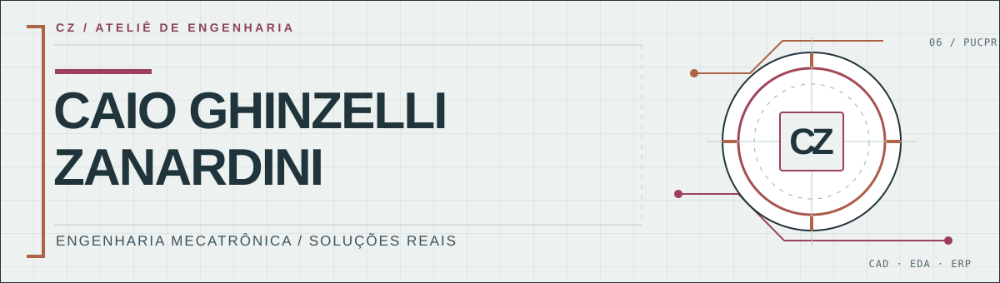

<picture>
  <source media="(prefers-color-scheme: dark)" srcset="./assets/cover-dark.svg">
  
</picture>

  <strong>Engenharia Mecatrônica · Automação · CAD / EDA · Software aplicado</strong>

  <a href="https://caio.zanardiniengenharia.com.br/">Portfólio e projetos</a>
  &nbsp;·&nbsp;
  <a href="https://www.linkedin.com/in/caiozanardini/">LinkedIn</a>
  &nbsp;·&nbsp;
  <a href="mailto:caio.ghinzelli@gmail.com">Contato</a>

### 01 / SOBRE

Sou estudante do **6º período de Engenharia Mecatrônica na PUCPR** e atuo com documentação técnica, componentes eletrônicos, PCBs e automação de processos de engenharia. Gosto de unir o projeto físico ao software para resolver problemas concretos e reduzir trabalho repetitivo.

Atualmente, trabalho na **Mendel Medical**, com atividades que conectam CAD/EDA, listas de materiais (BOMs), dados técnicos e rotinas de engenharia.

### 02 / PROJETOS E APLICAÇÕES

| Área | O que desenvolvi / explorei | Tecnologias |
| :--- | :--- | :--- |
| **BOMs e rastreabilidade** | Ferramenta para padronizar listas de materiais, organizar pendências e apoiar a validação de componentes. | Python, Excel/VBA, APIs REST |
| **Integração ECAD–MCAD** | Trabalho com PCBs, footprints, modelos 3D e documentação entre projeto eletrônico e mecânico. | KiCad, EAGLE, SolidWorks |
| **Operações industriais** | Aplicação com leitura de imagens para registros operacionais. Em uso, reduziu o tempo de um registro de cerca de 3 min para 30 s. | OCR, Excel, automação |

Os projetos com dados internos ou propriedade intelectual de terceiros são apresentados por meio de **estudos de caso e material anonimizado**, quando disponíveis.

### 03 / FERRAMENTAS

| Engenharia e eletrônica | Programação e automação | Processos e dados |
| :--- | :--- | :--- |
| SolidWorks · KiCad · EAGLE · TinyCAD | Python · C · C++ · VBA | TOTVS Protheus · Excel · Git · APIs REST |

### 04 / CONTATO

Estou aberto a conversas sobre **automação de processos, engenharia de produto, software aplicado e integração entre sistemas técnicos**.

**[Portfólio](https://caio.zanardiniengenharia.com.br/)** · **[LinkedIn](https://www.linkedin.com/in/caiozanardini/)** · **[E-mail](mailto:caio.ghinzelli@gmail.com)**

Curitiba e região, Paraná · Brasil
